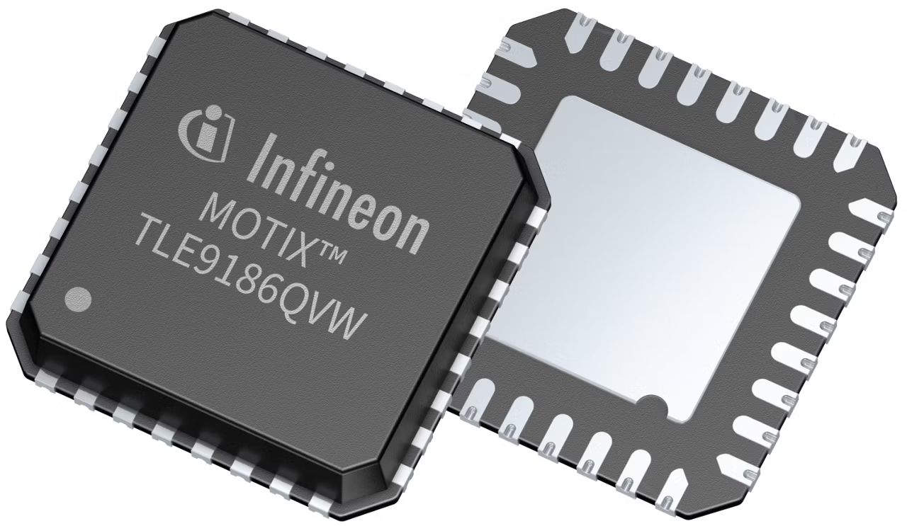

# MOTIX™ Repository

This repository contains device driver, code example projects and documentation for MOTIX™ motor driver ICs.

## Supported Product

<table>
    <tr>
        <td></td>
    </tr>
    <tr>
        <td style="test-align : center"><a href="https://www.infineon.com/part/TLE9186QVW">TLE9186 Product Website</a></td>
    </tr>
</table>

### Supported Frameworks

The device drivers should be supported by any microcontroller platform.

### More Information

More information regarding the MOTIX™ software offerings are available [here](https://www.infineon.com/design-resources/platforms/motix-software-tools/motix-software).

### License

See the [LICENSE](LICENSE.md) file for more details.